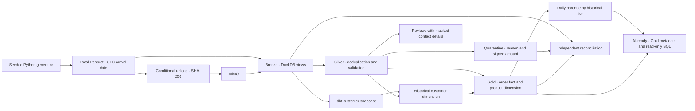

# Fault-Tolerant & AI-Ready E-Commerce Data Platform

[](https://github.com/Tanh2k8-123/Fault-Tolerant-AI-Ready-E-Commerce-Data-Platform/actions/workflows/ci.yml)

A reproducible e-commerce warehouse built with DuckDB and dbt. The pipeline injects five failure cases into synthetic orders and reviews, preserves rejected orders for audit, and exposes historical revenue through a read-only natural-language query demo.

For the default sample, **10,300 raw order rows** resolve to **9,850 valid orders and 150 quarantined records**. A dbt test independently reconstructs the latest orders from Bronze and reconciles both row count and signed amount against Gold plus quarantine.

## Quickstart

From the project root, run these three commands in an active Python 3.12 virtual environment. Use an empty local `data/` directory for the first run.

```sh
python -m pip install -r requirements.txt
python src/ingestion/chaos_generator.py --orders 10000 --reviews 1000 --output-dir data
dbt build --target local --project-dir dbt_project --profiles-dir dbt_project
```

The local build reads Parquet from `data/raw/` and writes the queryable warehouse to `data/ecommerce.duckdb`. It runs the customer snapshot and quality tests. Try the offline demo against that database:

```sh
python ai_serving/text_to_sql_demo.py "Doanh thu thuần theo hạng thành viên là bao nhiêu?"
```

## Architecture



Airflow processes one UTC arrival date at a time. Each run checks the raw partition, prepares Bronze views, snapshots customers, builds Silver and Gold, then runs dbt tests. Every task has two retries one minute apart. The local quickstart uses the same models as the MinIO-backed DAG. [Airflow DAG](orchestration/dags/ecommerce_pipeline_dag.py)

## Fault model

The default seed is 42. Order rates use the original order count as their denominator. The four order cohorts are disjoint. Review PII uses the review count as its denominator.

| Injected case | Rate and default count | Expected pipeline behavior |
|---|---|---|
| Revised order | 3% · 300 extra rows | Keep the latest quantity and amount. Half the revisions arrive the following day. |
| Missing key | 1% · 100 orders | Quarantine 50 missing order IDs and 50 missing customer IDs. Preserve each unkeyed physical row. |
| Negative amount | 0.5% · 50 orders | Quarantine the original signed amount so the revenue reconciliation balances. |
| Late arrival | 5% · 500 orders | Process arrivals delayed by one to three UTC days using the ingestion partition and incremental merge. |
| Contact details in reviews | 2% · 20 reviews | Mask synthetic email addresses and phone numbers while preserving the surrounding text. Reviews refer to valid orders already received. |

## Design decisions and trade-offs

- **DuckDB and Spark.** DuckDB runs the warehouse and tests in one process. This keeps the portfolio reproducible on a laptop. Its local memory, spill disk and single-writer database constrain concurrency. Distributed processing becomes worth its coordination cost when the working set or number of concurrent jobs exceeds that budget.
- **Arrival time and order time.** Raw paths follow `raw/<table>/dt=YYYY-MM-DD/part-<batch_id>-<shard>.parquet`, with `dt` derived from `ingested_at`. An old order appears in the batch that actually received it. Revenue uses the UTC order creation date, so event-time analysis can span several arrival partitions. The uploader uses conditional writes and compares checksums on retry.
- **Identity and quarantine.** Keyed revisions are ordered by `updated_at`, `ingested_at`, then `source_row_id`. Rows with null order IDs use their physical ID within the batch and a separate key namespace. This preserves every rejection even when a physical ID equals another order’s business ID.
- **Historical membership.** Gold joins each order to the customer interval containing its creation time, including the start and excluding the end. Silver daily history supplies versions that predate the first snapshot. A uniqueness test and an interval-overlap test guard against multiplying orders at the join.
- **Revenue and AI access.** GMV includes every valid order status. Net revenue sums completed orders only. Both use order-time amounts in VND. The demo reads these definitions from Gold metadata, validates the SQL structure, and opens DuckDB read-only with external access disabled. The offline mode supports three example questions. The optional Ollama mode accepts free-form questions. [Gold schema](dbt_project/models/gold/schema.yml) · [Text-to-SQL demo](ai_serving/text_to_sql_demo.py)

## Benchmark on five million orders

The March 2026 benchmark computes 30-calendar-day rolling net revenue by membership tier. Both queries produced the same 93 ordered rows from 4,925,000 valid Gold orders. They read the same temporary Parquet export partitioned by UTC order date. Export time is excluded.

| Query | Median wall time, 3 runs | Peak sampled process RSS | Fact files read |
|---|---:|---:|---:|
| Baseline · wide join and full history | 4.493 s | 857.9 MiB | 600 |
| Optimized · date pruning and explicit columns | 0.980 s | 238.0 MiB | 300 |

On this machine the optimized query ran **4.58× as fast**. For the March output it read January 31 through March 31, retaining the preceding 29 days needed for the first window. The report includes hardware and memory settings, individual timings, result checksum, both execution plans and reproduction commands. [Benchmark report](benchmarks/results.md)

## Operations and verification

For the orchestrated demo, copy `.env.example` to `.env`, set local MinIO credentials, and install GNU Make and Docker Compose. After generating the sample, run:

```sh
make up
make upload
make backfill START_DATE=2026-01-01 END_DATE=2026-01-02
```

Finish the upload before starting the backfill. The readiness task checks for an arriving shard. In Compose, Airflow uses its own persistent DuckDB file per batch. `make down` stops the stack and preserves the volumes.

Pull requests targeting `main` run Ruff and SQLFluff, pytest, deterministic sample generation, Bronze bootstrap, customer snapshot, Silver and Gold models, and dbt tests. The job has a two-minute timeout. The tests include signed-amount and row reconciliation, PII leakage checks and non-overlapping SCD2 intervals. [CI workflow](.github/workflows/ci.yml) · [dbt tests](dbt_project/tests)

## Scaling path to 100 TB

The measured workload is five million orders. The following is a proposed cloud design for a 100 TB workload:

1. Retain immutable arrival-partitioned objects in cloud storage. Compact small files into larger columnar files and track batch completion and checksums in a catalog.
2. Move Silver and Gold to transactional tables such as Iceberg. Use a distributed engine for heavy merges and backfills, and cluster curated orders by the date used in revenue queries. Measure file pruning, shuffle volume, memory pressure and cost per backfill.
3. Parallelize independent partitions while serializing updates that share business keys. Keep the existing null-key, temporal-join and signed-revenue checks as acceptance criteria. Expose curated Gold data to a read-only serving role and restrict access to raw PII and quarantine.
